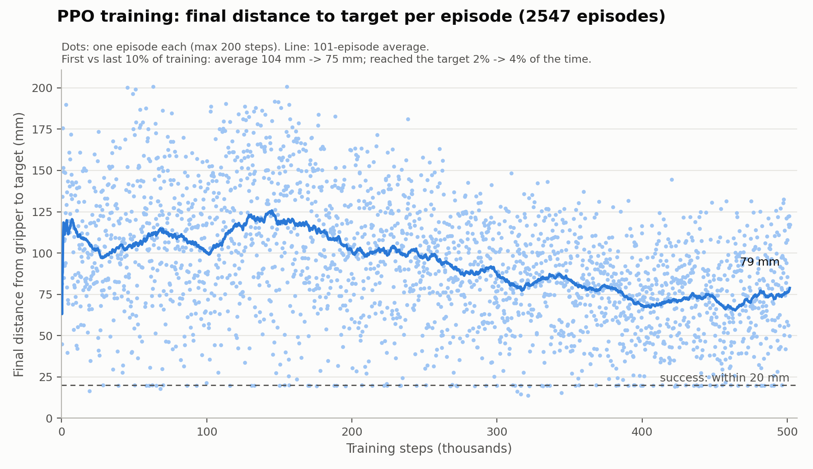
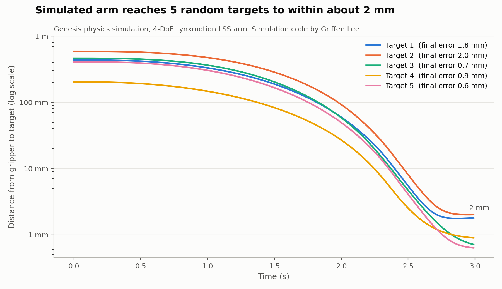

# RobotArm

Teaching a Lynxmotion LSS robotic arm to move to targets, three different ways.

I started by calculating the joint angles myself, moved on to recording
demonstrations by hand and training a transformer to imitate them, and then
used a physics simulator to generate far more training data than I could
record by hand. Each approach taught me why I needed the next one.

<!-- TODO: add a photo or GIF of the real arm here, e.g.

-->

<!-- TODO: link videos of the real robot moving here -->

| | Approach | Folder |
|---|---|---|
| 1 | **Inverse kinematics**: do the math, send each servo to an exact position | [`1_inverse_kinematics/`](1_inverse_kinematics/) |
| 2 | **Learning from demonstration**: move the arm by hand, record it, train a GPT-style model to imitate it | [`2_learning_from_demonstration/`](2_learning_from_demonstration/) |
| 3 | **Simulation**: train a policy in a physics simulator to get much more data | [`3_simulation/`](3_simulation/) |

Every code file starts with a comment block explaining what it does and how it
fits into the project.

## The hardware

- Lynxmotion LSS arm with 5 smart servos: base rotation, shoulder, elbow,
  wrist, and claw
- Controlled from Python over USB serial (`/dev/ttyUSB0`) with Lynxmotion's
  LSS library (`lss.py`)
- Servo positions are in tenths of a degree (900 = 90°)

---

## 1. Inverse kinematics

**Idea:** if I know the length of each link of the arm, I can calculate the
angle each joint needs to put the claw on a target point, and then send each
servo straight to that number.

- [`hardcoded_pose_fk.py`](1_inverse_kinematics/hardcoded_pose_fk.py): where I
  started. It sends each servo to a position I worked out by hand, reads the
  positions back, and uses **forward kinematics** (sin/cos for each link) to
  calculate where the tip of the arm ends up.
- [`jacobian_ik.py`](1_inverse_kinematics/jacobian_ik.py): the full solver.
  1. Rotate the base to face the target: `atan2(y, x)`.
  2. Solve the shoulder and elbow numerically with a **Jacobian-transpose**
     loop: compute where the tip is, compare it to the target, nudge each
     joint in the direction that reduces the error, and repeat until it is
     within tolerance.
  3. Check the result with forward kinematics, then send the servos there.

  The file also keeps my earlier attempts on the way there: forward kinematics
  with trigonometry, the same calculation with 4×4 homogeneous transformation
  matrices, and a closed-form 2-link solution using the law of cosines.

**What I learned:** this works for one point at a time, but every new target
or motion needs new math, and small differences between my measurements and
the real arm show up as errors. I wanted the arm to *learn* motions instead.

## 2. Learning from demonstration

**Idea:** instead of calculating motions, show the arm what to do. I move the
arm by hand while the servos report their positions, then train a model to
reproduce the motion, the same way a language model learns to continue text.

1. **Record:** [`record_robot.py`](2_learning_from_demonstration/record_robot.py)
   reads all 5 servo positions every 0.05 s while I move the arm through a
   task. I recorded **186 demonstrations** of three tasks (pick, reach, place),
   which are in [`dataset/`](2_learning_from_demonstration/dataset/). Each file
   starts with a one-hot task label and a start token, followed by one line of
   5 servo positions per time step.
2. **Model:** [`gpt.py`](2_learning_from_demonstration/gpt.py) is a small
   GPT-style transformer. I learned how to build one from Andrej Karpathy's
   video [*Let's build GPT: from scratch, in code, spelled out*](https://www.youtube.com/watch?v=kCc8FmEb1nY),
   which builds a model that generates text one character at a time, and then
   adapted it for robot motion:
   - each "token" is a vector of 5 servo positions instead of a character
   - a linear layer replaces the character-embedding table, because servo
     positions are continuous numbers
   - the model predicts the next 5 positions with a mean-squared-error loss
     instead of picking the next character with cross-entropy
   - a one-hot task label and a start token at the beginning of each sequence
     tell the model which motion to generate
3. **Train:** [`train.py`](2_learning_from_demonstration/train.py) trains one
   model on all tasks, using the task label to tell them apart.
   [`train_s.py`](2_learning_from_demonstration/train_s.py) trains a separate
   model for each task. Training is logged to Weights & Biases.
4. **Run on the arm:** [`inf_s.py`](2_learning_from_demonstration/inf_s.py)
   generates a motion one step at a time and sends it to the servos. Testing
   on the real arm led me to add:
   - starting from real recorded frames
   - clamping to safe servo limits, including a tighter range for the claw so
     it doesn't stall
   - smoothing to remove jitter
   - a gentle return to the home pose

   [`pad_dataset.py`](2_learning_from_demonstration/pad_dataset.py) pads each
   demonstration with its final pose so the model learns to *stop*.

`first_version/` has my first recorder, which put the servos in limp mode and
logged to a CSV, and one of the first recordings.

**What I learned:** the model can only be as good as its data, and recording
demonstrations by hand is slow, so 186 demonstrations is a small dataset. That
led to simulation, where data is effectively free.

## 3. Simulation

**Idea:** build the arm in a physics simulator, generate as much data as I
want, train there, then transfer the result to the real arm (sim-to-real).

- [`test_arm.py`](3_simulation/test_arm.py) loads the arm's URDF model into
  the [Genesis](https://github.com/Genesis-Embodied-AI/Genesis) physics
  simulator.
- [`train.py`](3_simulation/train.py) wraps the simulation as a Gymnasium
  environment and trains a policy with **PPO reinforcement learning**. The
  reward is minus the distance from the claw to a random target.
- [`eval_sim.py`](3_simulation/eval_sim.py) tests the policy and records
  [`trained_arm_eval.mp4`](3_simulation/trained_arm_eval.mp4).
- [`deploy_real.py`](3_simulation/deploy_real.py) runs the policy on the real
  arm: read the joints, ask the policy for the next move, send it, with every
  move capped for safety.
- [`training_dataset.csv`](3_simulation/training_dataset.csv) maps target
  positions to joint angles, for training a model to go straight from a target
  to the joint angles.

### Results

**Training curve.** [`train_logged.py`](3_simulation/train_logged.py) runs my
`train.py` environment and PPO settings for 500k steps, with a 200-step limit
per episode so progress can be measured:



Over training, the average final distance to the target dropped from about
104 mm to about 75 mm, and the arm reached the target (within 2 cm) about 4% of
the time, up from 2%. It is learning, but it is not reliable yet. Next I want to
try reward shaping and longer training.

**Simulated reaching** (simulation built by collaborator Griffen Lee, see
Credits): Genesis renders of my arm, and a task that drives it to 5 random
targets with a scripted controller, finishing within about 2 mm of each with no
collisions. This shows the simulated arm model is accurate enough to train on.




Videos: [dot 0](https://github.com/Surina-10/robot_single_arm_testing/blob/main/outputs/reach/reach_4dof_dot0.mp4) ·
[dot 1](https://github.com/Surina-10/robot_single_arm_testing/blob/main/outputs/reach/reach_4dof_dot1.mp4) ·
[dot 2](https://github.com/Surina-10/robot_single_arm_testing/blob/main/outputs/reach/reach_4dof_dot2.mp4) ·
[dot 3](https://github.com/Surina-10/robot_single_arm_testing/blob/main/outputs/reach/reach_4dof_dot3.mp4) ·
[dot 4](https://github.com/Surina-10/robot_single_arm_testing/blob/main/outputs/reach/reach_4dof_dot4.mp4)

Recreate the graphs:

```bash
cd 3_simulation
python plot_training.py logs/training_500k.monitor.csv
python plot_reach_distance.py ~/robot_single_arm_testing
```

## What's next

- Make the observation used in simulation training match the one used on the
  real arm, so the trained policy transfers directly.
- Reward shaping and longer training for the PPO policy.
- Combine approaches 2 and 3: pre-train the transformer on simulated motions,
  then fine-tune it on my real demonstrations.

## Running it

```bash
pip install genesis-world stable-baselines3 gymnasium torch numpy matplotlib pyserial wandb

python 1_inverse_kinematics/jacobian_ik.py                    # real arm: IK to a target
cd 2_learning_from_demonstration
python record_robot.py                                        # record demonstrations
python train_s.py                                             # train per-task models
python inf_s.py                                               # run on the real arm
cd ../3_simulation
python train.py                                               # PPO in simulation
python eval_sim.py                                            # evaluate + record video
```

Genesis needs a CPU with AVX and, for speed, an NVIDIA GPU.

## Credits

- **Genesis simulation, reach task and IK dataset tools:** written by
  **Griffen Lee** and used here with his permission.
  Original: [grifflee/robot_single_arm_testing](https://github.com/grifflee/robot_single_arm_testing),
  my fork: [Surina-10/robot_single_arm_testing](https://github.com/Surina-10/robot_single_arm_testing).
  The reach graph, renders and reach videos above come from that project.
- **GPT architecture in `gpt.py`:** based on Andrej Karpathy's
  [*Let's build GPT: from scratch, in code, spelled out*](https://www.youtube.com/watch?v=kCc8FmEb1nY),
  adapted by me for continuous robot servo positions.
- **`lss.py`, `lss_const.py`:** Lynxmotion LSS Python library by Sebastien
  Parent-Charette (RobotShop), LGPL-3.0. The two approach 1 scripts started
  from that library's example `test.py`.
- **`3_simulation/lss_arm.urdf`, `package.xml`, `CMakeLists.txt`:** from the
  `lss_arm_description` package in
  [Lynxmotion/LSS-ROS2-Arms](https://github.com/Lynxmotion/LSS-ROS2-Arms),
  Apache-2.0.
 - **Research mentorship:** This project was done at Loyola University Chicago under Prof. Neil Klingensmith.
