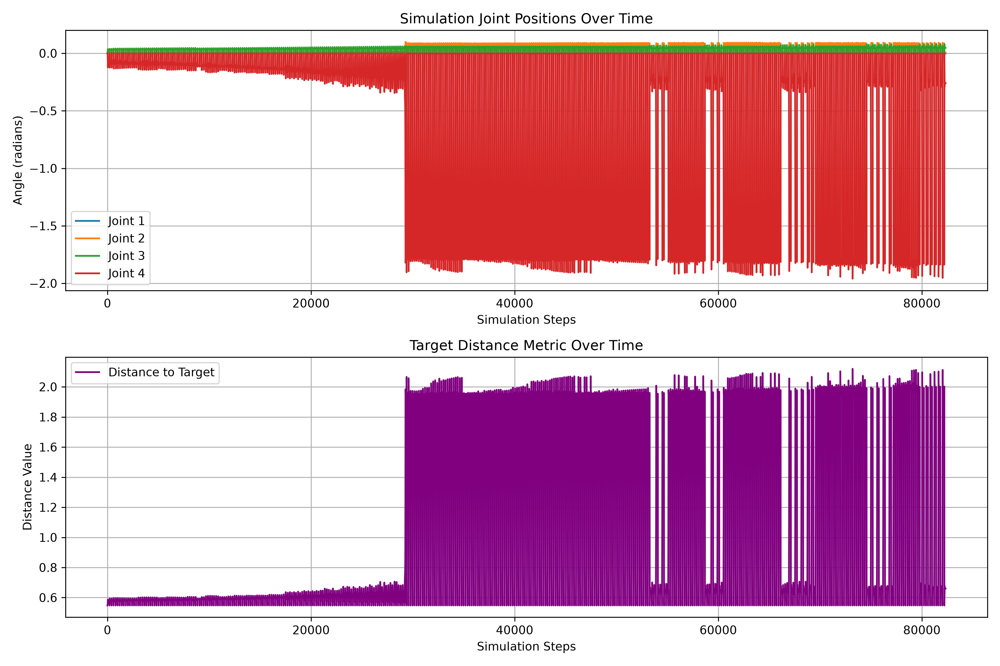

# RobotArm

A Lynxmotion LSS 4-DoF robotic arm that I control from Python, simulate in the
[Genesis](https://github.com/Genesis-Embodied-AI/Genesis) physics engine, and
train with reinforcement learning (PPO) to reach target positions in 3D space.
The goal is **sim-to-real**: train a policy in simulation, then run it on the
physical arm.

<!-- TODO: add a photo or GIF of the real arm here, e.g.

-->

## How it works

```
 Genesis simulation ──► PPO training ──► lss_arm_policy.zip ──► real LSS servos
   (train.py)            (Stable-Baselines3)                      (deploy_real.py)
```

1. **Simulate the arm.** The arm's URDF model is loaded into Genesis with a
   ground plane (`test_arm.py`).
2. **Train a reaching policy.** `train.py` wraps the Genesis scene as a
   Gymnasium environment. Each episode picks a random 3D target; the policy
   outputs small joint-angle changes and is rewarded for moving the end of the
   arm closer to the target. Training uses PPO from Stable-Baselines3 and saves
   `lss_arm_policy.zip`.
3. **Evaluate in simulation.** `eval_sim.py` runs the trained policy on 5 new
   targets, prints the final distance for each, and records
   `trained_arm_eval.mp4` with an offscreen camera.
4. **Run on the real arm.** `deploy_real.py` connects to the LSS smart servos
   over USB serial, reads their joint angles, asks the policy for the next
   move, and sends position commands, capping each step for safety.
5. **Record demonstrations.** With ROS 2, `ik_teleop.py` solves inverse
   kinematics (ikpy) for a target point and publishes joint states, and
   `record_joints.py` logs them to `motion_demonstration.csv`.

## Results

| Policy in simulation | Simulated joint angles over time |
|---|---|
| [`trained_arm_eval.mp4`](trained_arm_eval.mp4) |  |

**Reach-task simulation** (built by collaborator Griffen Lee, see Credits):
Genesis renders of my arm, and a task that drives it to 5 random targets,
finishing within 0.6–2.0 mm of each with no collisions.


Videos: [dot 0](https://github.com/Surina-10/robot_single_arm_testing/blob/main/outputs/reach/reach_4dof_dot0.mp4) ·
[dot 1](https://github.com/Surina-10/robot_single_arm_testing/blob/main/outputs/reach/reach_4dof_dot1.mp4) ·
[dot 2](https://github.com/Surina-10/robot_single_arm_testing/blob/main/outputs/reach/reach_4dof_dot2.mp4) ·
[dot 3](https://github.com/Surina-10/robot_single_arm_testing/blob/main/outputs/reach/reach_4dof_dot3.mp4) ·
[dot 4](https://github.com/Surina-10/robot_single_arm_testing/blob/main/outputs/reach/reach_4dof_dot4.mp4)

<!-- TODO: link your videos of the real robot moving here -->

## Files

| File | What it does |
|---|---|
| `test_hardware.py` | Checks the USB serial link by reading servo 1's position |
| `test_arm.py` | Loads the arm into Genesis and prints its degrees of freedom |
| `train.py` | Genesis + Gymnasium environment and PPO training |
| `gen_and_train.py` | Collects randomized simulation rollouts (with joint-noise domain randomization) |
| `eval_sim.py` | Evaluates the trained policy and records a video |
| `plot_obs.py` | Plots recorded simulation observations to `simulation_plot.png` |
| `deploy_real.py` | Runs the policy on the physical arm |
| `ik_teleop.py`, `record_joints.py` | ROS 2 inverse-kinematics teleop and joint recording |
| `training_dataset.csv` | Target position → joint angles (`target_x,target_y,target_z,q1..q4,q5_claw`) |
| `lss_arm_policy.zip` | Trained PPO policy |
| `lss.py`, `lss_const.py` | Lynxmotion LSS servo library (third-party, see Credits) |
| `lss_arm.urdf`, `package.xml`, `CMakeLists.txt` | Arm model and ROS package files (third-party, see Credits) |

## Running it

```bash
pip install genesis-world stable-baselines3 gymnasium torch numpy matplotlib pyserial
python test_arm.py        # load the arm in simulation
python train.py           # train the policy
python eval_sim.py        # evaluate + record video
python deploy_real.py     # run on the real arm (servos on /dev/ttyUSB0)
```

Genesis needs a CPU with AVX and, for speed, an NVIDIA GPU.

## What I'm working on next

- Making the observation used in training (joint angles + target position)
  match the one used on the real arm (joint angles + velocities + distance),
  so the trained policy transfers directly.
- Using the kinematics dataset to train a model that maps a target position
  straight to joint angles.

## Credits

- **Genesis simulation, reach task and IK dataset tools:** written by
  **Griffen Lee** and used here with his permission.
  Original: [grifflee/robot_single_arm_testing](https://github.com/grifflee/robot_single_arm_testing),
  my fork: [Surina-10/robot_single_arm_testing](https://github.com/Surina-10/robot_single_arm_testing).
  The renders and reach videos linked above come from that project.
- **`lss.py`, `lss_const.py`:** Lynxmotion LSS Python library by Sebastien
  Parent-Charette (RobotShop), LGPL-3.0.
- **`lss_arm.urdf`, `package.xml`, `CMakeLists.txt`:** from the
  `lss_arm_description` package in
  [Lynxmotion/LSS-ROS2-Arms](https://github.com/Lynxmotion/LSS-ROS2-Arms),
  Apache-2.0.
